# OneDAO – JWT Authentication & Product Management API

A RESTful backend built with **Java 17, Spring Boot 3.2, Spring Security, PostgreSQL and JWT**, with Swagger/OpenAPI documentation.

## Features

- User sign-up with validation, BCrypt password hashing and OTP verification
- Sign-up blocked for unauthorized countries (country resolved from the client's IP)
- JWT login (HS256, with `subject`, `role`, `jti`, `iat` and `exp` claims)
- Role-based access: `/api/settings` is **Administrator only**
- Logout with server-side token revocation (a logged-out token gets 401 everywhere)
- Product CRUD with **pagination, sorting and filtering**
- Global exception handling with clean JSON error responses
- Swagger UI with a Bearer-token "Authorize" button, plus a ready-to-import Postman collection
- Unit tests for the country-restriction logic (`mvn test`)

## Tech stack

| Layer | Technology |
|---|---|
| Language / Framework | Java 17, Spring Boot 3.2.5 |
| Security | Spring Security, jjwt 0.12.5, BCrypt |
| Database | PostgreSQL (Spring Data JPA / Hibernate) |
| API docs | springdoc-openapi 2.5.0 (Swagger UI) |

## Getting started

### Prerequisites
- JDK 17 or later
- Maven 3.8+ (or use the Run button in your IDE)
- PostgreSQL with an empty database named `onedao_db`

### 1. Configure
`src/main/resources/application.properties` reads the database credentials from environment variables, with defaults:

```properties
spring.datasource.url=jdbc:postgresql://localhost:5432/onedao_db
spring.datasource.username=${DB_USERNAME:postgres}
spring.datasource.password=${DB_PASSWORD:postgres}
```

Either set the `DB_PASSWORD` environment variable (and `DB_USERNAME` if it is not `postgres`), or edit the default value in the file. Optionally set `JWT_SECRET` to your own signing key.

Tables (`users`, `products`) are created automatically on first run.

### 2. Run
```bash
mvn spring-boot:run
```
The app starts on **http://localhost:8080**.

### 3. Open Swagger UI
**http://localhost:8080/swagger-ui.html**

To call protected endpoints: log in, copy the `token` from the response, click **Authorize**, and paste the token (without the `Bearer ` prefix).

## Configuration reference

| Property | Default | Description |
|---|---|---|
| `app.jwt.secret` | `${JWT_SECRET:<dev default>}` | HMAC signing key (at least 32 characters). Set the `JWT_SECRET` environment variable for real use. |
| `app.jwt.expiration-ms` | `3600000` | Token lifetime (1 hour) |
| `app.blocked-countries` | `SY,AF,IR,KP` | ISO country codes that cannot sign up |
| `app.otp.required` | `false` | If `true`, users must verify OTP before they can log in |
| `app.otp.expiry-minutes` | `5` | OTP validity |

## API endpoints

| Method | URL | Access | Description |
|---|---|---|---|
| POST | `/api/auth/signup` | Public | Register a user (validation + country check) |
| POST | `/api/auth/verify-otp` | Public | Verify the OTP (printed in the server console) |
| POST | `/api/auth/login` | Public | Returns a JWT. A bad login redirects (303) to `/api/error` |
| GET | `/api/error` | Public | Returns `Login Failed` (401) |
| GET | `/api/dashboard` | Authenticated | Returns `Welcome <Username>` |
| GET | `/api/settings` | **Administrator** | Returns the settings message (403 for Standard User) |
| POST | `/api/auth/logout` | Authenticated | Returns `<Username> Logged Out` and revokes the token |
| POST | `/api/products` | Authenticated | Create a product |
| GET | `/api/products` | Authenticated | List products (pagination, sorting, filtering) |
| GET | `/api/products/{id}` | Authenticated | Get one product |
| PUT | `/api/products/{id}` | Authenticated | Update a product |
| DELETE | `/api/products/{id}` | Authenticated | Delete a product |

Product APIs are open to any authenticated user (both roles), as the requirements only restrict the Settings endpoint to Administrators.

### Product list query parameters

| Param | Default | Notes |
|---|---|---|
| `page` | `0` | Zero-based page index |
| `size` | `10` | Clamped to 1–100 |
| `sortBy` | `id` | One of `id`, `name`, `price`, `quantity`, `createdAt` |
| `direction` | `asc` | `asc` or `desc` |
| `name` | none | Case-insensitive "contains" filter |

Example: `GET /api/products?page=0&size=5&sortBy=price&direction=desc&name=lap`

## Validation rules

| Field | Rule |
|---|---|
| Username | 8 to 50 characters |
| Email | Must contain `@` and `_` |
| Password | 8 to 12 characters with at least 1 capital letter, 1 small letter, 1 number and 1 special character |
| User Type | `Standard User` or `Administrator` |
| Product price | Greater than 0 |
| Product quantity | 0 or more |

Passwords are stored only as **BCrypt hashes** (`$2a$10$...`).

## Sample requests

**Sign up (Administrator)**
```json
{
  "username": "admin_user3",
  "email": "admin_user3@mail.com",
  "password": "Admin@123",
  "userType": "Administrator"
}
```

**Sign up (Standard User)**
```json
{
  "username": "standard_user3",
  "email": "standard_user3@mail.com",
  "password": "Std@1234",
  "userType": "Standard User"
}
```

**Verify OTP** (the OTP is logged in the server console as `OTP for <user> = ******`)
```json
{ "username": "admin_user3", "otp": "123456" }
```

**Login**
```json
{ "username": "admin_user3", "password": "Admin@123" }
```
Response:
```json
{ "token": "<jwt>", "type": "Bearer", "message": "Login successful. Use the token to call /api/dashboard" }
```

**Create product**
```json
{ "name": "Laptop", "description": "14 inch", "price": 999.99, "quantity": 5 }
```

## Quick test flow

1. Sign up an Administrator and a Standard User.
2. Log in as the Administrator and authorize with the token.
3. `GET /api/dashboard` returns `Welcome admin_user3`.
4. `GET /api/settings` returns 200. With the Standard User's token it returns 403.
5. A wrong-password login ends at `/api/error` with `Login Failed`.
6. `POST /api/auth/logout` returns `admin_user3 Logged Out`. Calling `/api/dashboard` with the same token then returns 401.
7. Create, list (with pagination and sorting), update and delete products.

## Error response format

```json
{
  "status": 400,
  "message": "Validation failed",
  "errors": { "username": "Username must be 8 to 50 characters" }
}
```

| Code | Meaning |
|---|---|
| 400 | Validation failure or malformed request |
| 401 | Missing, invalid, expired or revoked token |
| 403 | Authenticated but not allowed (e.g. Standard User on Settings), or blocked country at sign-up |
| 404 | Resource not found |
| 405 | HTTP method not supported |
| 409 | Duplicate username or email |
| 415 | Unsupported content type |

## Design notes

- **Country check:** the client IP is taken from the connection's remote address and resolved to a country via ip-api.com. The `X-Forwarded-For` header is deliberately ignored because clients can spoof it and bypass the check. For local requests the server's public IP is used. The lookup has a 3-second timeout; if it fails, sign-up is allowed (fail-open) and a warning is logged.
- **Logout:** each token carries a unique `jti`. Logout adds it to an in-memory revocation list, so tokens are rejected immediately. The list resets when the app restarts.
- **OTP:** simulated by logging the code to the server console, as no email or SMS provider is configured. Set `app.otp.required=true` to enforce it at login.
- **Security:** stateless sessions, CSRF disabled (token-based API), parameterized queries through JPA, and whitelisted sort fields to prevent injection.
- **JWT:** signed with HMAC-SHA256 (HS256); the signing secret is read from the `JWT_SECRET` environment variable.
- **Data storage:** users and products are persisted in PostgreSQL, as required by the job description. Only the logout token revocation list is held in memory.
- **Error handling:** a global handler returns clean JSON for validation errors (400), unsupported methods (405), unsupported content types (415), unknown resources (404) and duplicates (409). Unexpected server errors return a generic 500 and are logged server-side.

## Known limitations and planned improvements

This submission focuses on the functional requirements. The following are known gaps and the improvements I would make next:

- **Service layer:** business logic currently lives in the controllers (`AuthController`, `ProductController`). Next step is to extract `AuthService` and `ProductService` so controllers stay thin and the logic is easier to test.
- **Automated tests:** unit tests currently cover the country-restriction logic (`GeoServiceTest`, `AuthControllerGeoTest`). The rest of the API was tested manually through Swagger and Postman. Next step is to add unit tests for the JWT utility and password/email validation, plus MockMvc integration tests for role-based access and logout revocation.
- **Enum for user types:** `"Administrator"` and `"Standard User"` are plain strings. A `UserType` enum would remove the magic strings.
- **Response DTOs:** the product endpoints return the `Product` entity directly. A `ProductResponse` DTO would decouple the API from the table structure.
- **Richer API docs:** add `@Tag` and `@Operation` Swagger annotations with example responses.
- **Brute-force protection:** there is no rate limiting on login or OTP verification. Adding rate limiting and an OTP attempt limit would harden this.
- **Token revocation storage:** the logout blacklist is in memory, so it resets on restart and does not work across multiple instances. Redis (with a TTL equal to the token expiry) would fix this.
- **Database migrations:** `spring.jpa.hibernate.ddl-auto=update` is used for convenience. A production setup would use Flyway or Liquibase.
- **OTP delivery:** the OTP is logged to the console instead of being sent by email or SMS.

## Project structure

```
src/main/java/com/onedao/auth
├── config        SecurityConfig, OpenApiConfig
├── controller    AuthController, DashboardController, ProductController
├── dto           SignupRequest, LoginRequest, OtpRequest, ProductRequest
├── entity        User, Product
├── exception     GlobalExceptionHandler
├── repository    UserRepository, ProductRepository
├── security      JwtUtil, JwtAuthFilter, TokenBlacklist
└── service       GeoService

src/test/java/com/onedao/auth
├── GeoServiceTest
└── AuthControllerGeoTest

docs/
├── onedao-auth.postman_collection.json
└── screenshots/
```

## Testing

A Postman collection is available at [`docs/onedao-auth.postman_collection.json`](docs/onedao-auth.postman_collection.json). Import it, run one of the **Login** requests first (it saves the token automatically), then run any other request. All endpoints were also tested through Swagger UI. Results are shown below.

Run the automated unit tests with:

```bash
mvn test
```

| Test class | What it verifies |
|---|---|
| `GeoServiceTest` | Blocked-country list logic (SY, AF, IR, KP blocked; IN, US allowed) |
| `AuthControllerGeoTest` | Sign-up from a blocked country is rejected with 403 Forbidden and no user is saved |

## Screenshots

### Swagger UI (API documentation)
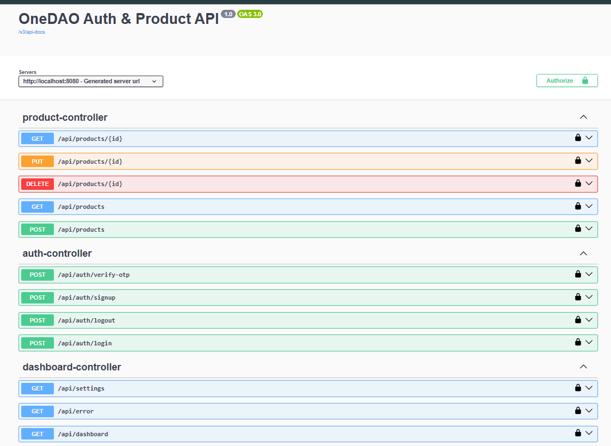

### Sign-up: validation, country check and OTP
Successful registration returns **201**:

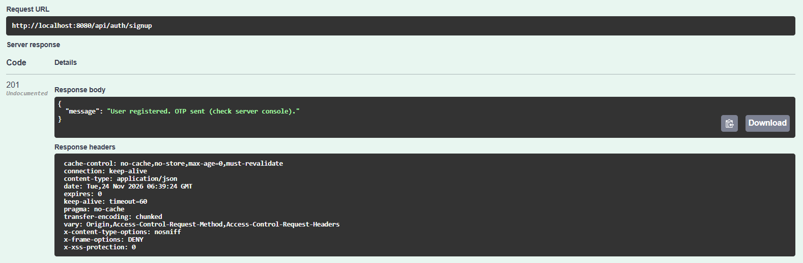

### OTP verification
The OTP is printed in the server console after sign-up (`OTP for <user> = ******`). Submitting the correct OTP returns **200**:

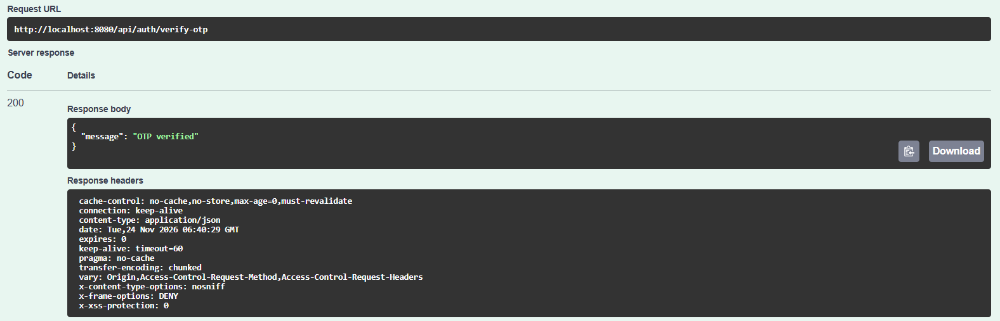

### Login: returns a JWT
A valid login returns **200** with a Bearer token (shortened in the screenshot):

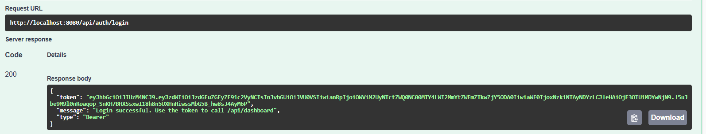

### Dashboard: `Welcome <Username>`
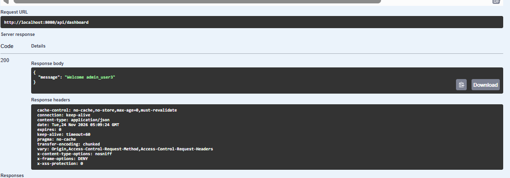

### Role management: Settings is Administrator only
Administrator token returns **200**:

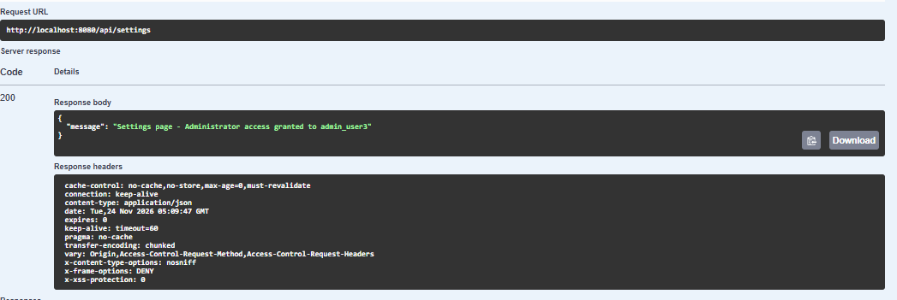

Standard User token returns **403 Forbidden**:

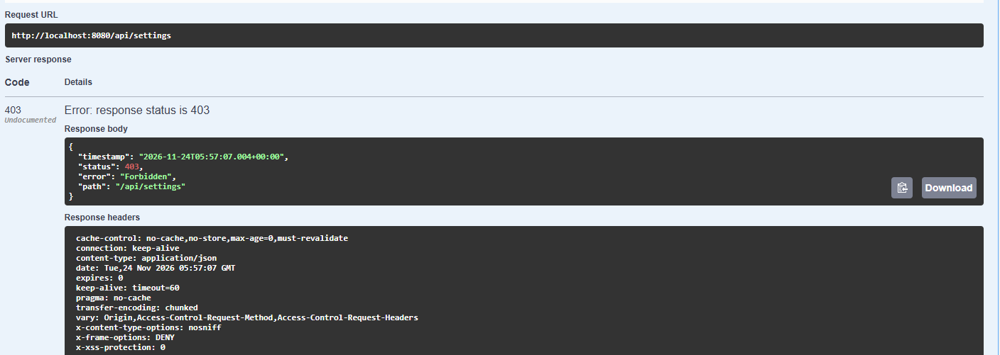

### Logout: `<Username> Logged Out`
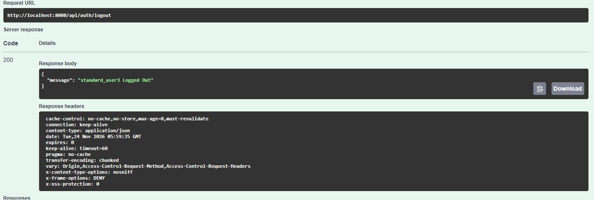

After logout, the same token is rejected with **401**:

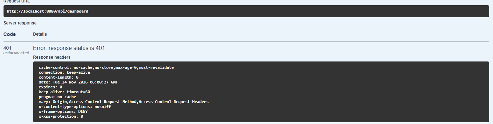

### Product list with pagination and sorting
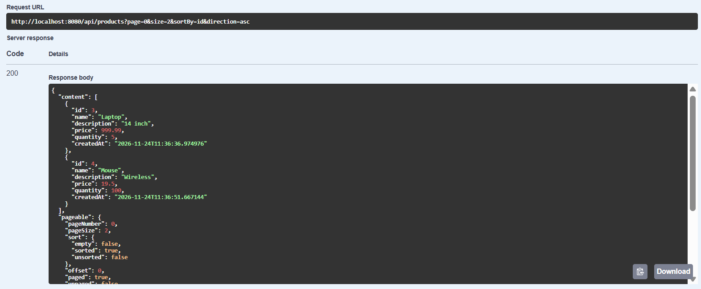

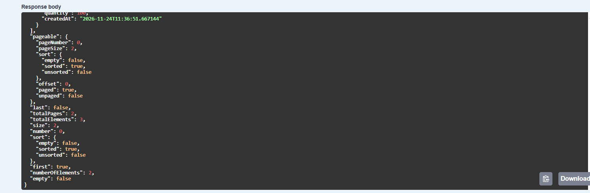

### Passwords stored as BCrypt hashes (`$2a$10$...`)
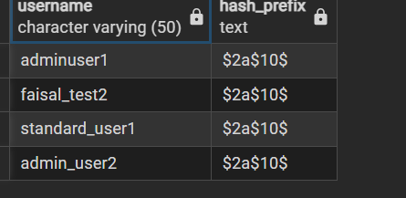

## Author

Mo Faishal Qureshi
